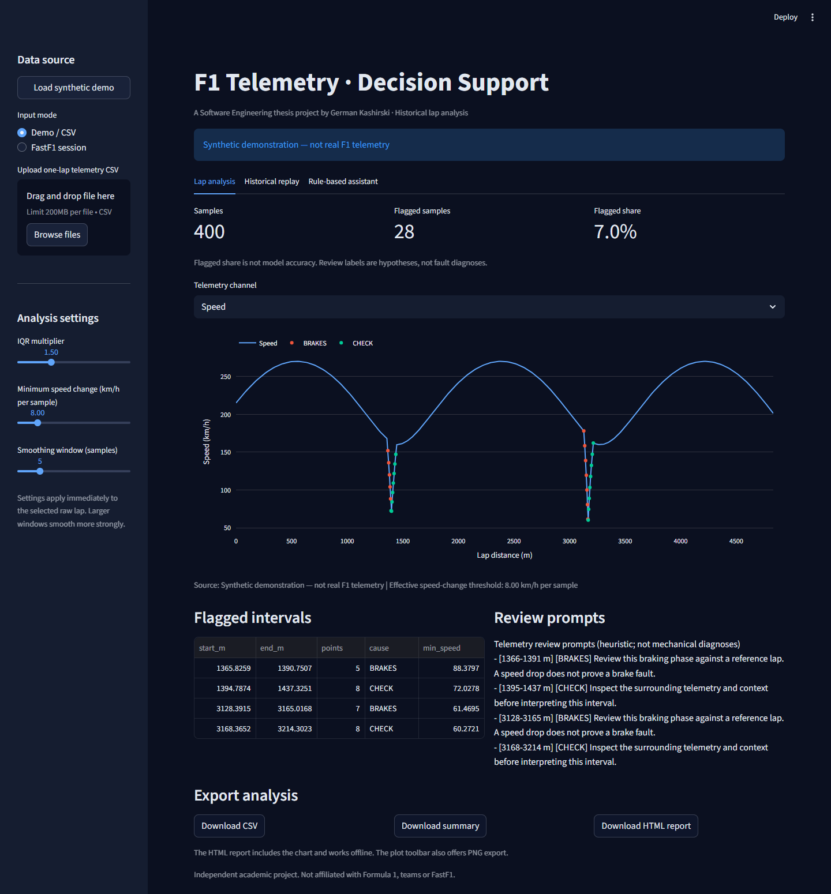
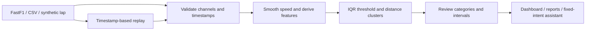

# F1 Telemetry Decision Support

[](https://github.com/Germanskii/f1-telemetry-dss/actions/workflows/checks.yml)

A reproducible Python workflow for exploring Formula 1 lap telemetry: validate
samples, derive time-aware features, inspect unusual speed changes and export
an interactive report. Developed from German Kashirski’s 2026 Software Engineering
bachelor’s thesis at **RTU MIREA**.

Explore a lap, highlight unusual speed-change intervals, inspect the rules behind
the labels, and replay recorded telemetry. Start with a deterministic synthetic
example, upload a one-lap CSV, or download historical telemetry through FastF1.

**Python · Streamlit · Plotly · pandas · NumPy · FastF1**



## What you can do

- Analyze a selected driver and lap from a historical FastF1 session.
- Run completely offline using the built-in synthetic demonstration.
- Adjust the IQR multiplier, minimum speed change and smoothing window.
- Inspect flagged intervals and consistent, deterministic review prompts.
- Replay timestamped samples with start, pause, reset and speed controls.
- Ask a rule-based assistant for a summary, intervals, categories or comparison of lap halves.
- Download analysis CSV, JSON summary and a self-contained interactive HTML report.
  The chart toolbar provides browser-side PNG export.

This is an **academic, rule-based decision-support prototype**. It does not diagnose
mechanical faults, connect to live race telemetry, or use a trained ML model or LLM.
Ordinary cornering and braking can trigger flags. The flagged percentage is **not accuracy**.

## Results you can reproduce

Rechecked locally on **29 October 2026**, Windows / Python 3.10.11:

| Scenario | Samples | Flagged samples | What it demonstrates |
| --- | ---: | ---: | --- |
| Synthetic lap, default settings | 400 | 28 (7.0%) | Offline analysis, category summaries and report export |
| Same lap, minimum change raised from 8 to 40 km/h per sample | 400 | 0 | The threshold control changes the analysis |
| 2023 Italian GP qualifying, fastest lap: SAI, lap 19, from local cache | 296 | 27 (9.12%) | Integration with historical FastF1 car telemetry |

The default synthetic result contains 12 `BRAKES` and 16 `CHECK` labels. Historical
telemetry contains ordinary driving events; flagged points are review candidates,
not confirmed faults. Neither row measures precision, recall or racing improvement.

**Software checks:** 14 pytest cases passed, including Streamlit AppTest; dependency,
lint and formatting checks passed. The published baseline also has a successful
[GitHub Actions run on Python 3.10 and 3.12](https://github.com/Germanskii/f1-telemetry-dss/actions/runs/35870852318).
See [reproduction commands and result interpretation](docs/RESULTS.md),
[example JSON output](docs/examples/demo-summary.json) and the [validation record](docs/VALIDATION.md).

## Technical scope

| Area | Implementation | Evidence |
| --- | --- | --- |
| Data analysis | pandas / NumPy validation, rolling smoothing, elapsed-time acceleration, IQR thresholds and distance-based intervals | `src/data_pipeline/preprocessing/`, `src/models/` |
| Visualization | Streamlit controls, Plotly channel charts and downloadable CSV / JSON / standalone HTML | `src/dashboard/app.py`, `src/analysis.py` |
| Data ingestion | FastF1 historical sessions with local caching, one-lap CSV input and deterministic synthetic data | `src/data_pipeline/load_fastf1_data.py`, `src/demo/` |
| Reproducibility | Pinned direct dependencies, shared UI / CLI analysis, pytest, Ruff and GitHub Actions | `requirements*.txt`, `tests/`, `.github/workflows/checks.yml` |

The project demonstrates exploratory analysis and local data-pipeline foundations.
For ML work, its contribution is feature engineering and an explainable heuristic
baseline; model training, labelled evaluation and deployment remain future work.
The current pipeline runs locally in memory and local files; it has no database,
workflow scheduler or distributed processing layer.

## Quick start

Use Python **3.11–3.12** for the refreshed dependencies. The October audit uses
Python 3.12.10 on Windows; the workflow is configured for 3.11 and 3.12 on Linux.
Python 3.10 belongs to the earlier validation record and is no longer supported
by these pins. No API key is required.

```bash
git clone https://github.com/Germanskii/f1-telemetry-dss.git
cd f1-telemetry-dss
python -m venv .venv
```

Activate on Windows PowerShell:

```powershell
.\.venv\Scripts\Activate.ps1
```

Or on macOS/Linux:

```bash
source .venv/bin/activate
```

Then:

```bash
python -m pip install --upgrade pip
python -m pip install -r requirements.txt
python -m streamlit run src/dashboard/app.py
```

Open the local URL printed by Streamlit (normally `http://localhost:8501`).
The synthetic example appears immediately; no race download is attempted at startup.
If PowerShell blocks activation, run `.\.venv\Scripts\python.exe` instead of `python`.

### A short walkthrough

1. Inspect the synthetic lap: **400 samples**, **28 flagged**, **7.0% flagged share**.
2. Switch between Speed and Acceleration; inspect the flagged intervals and review prompts.
3. Raise **Minimum speed change** to **40**: the flagged count becomes **0**.
   Restore **8** to recover the default result.
4. Download the HTML report and open it locally. It includes the chart, settings
   and summary, with no network connection needed to view it.
5. Open **Historical replay**, start playback, then pause and reset it.
   This replays recorded samples using their timestamps.

No hosted demo is provided. The screenshot above uses the same synthetic input;
the local dashboard and CLI are the runnable demonstrations.

### Historical session

Select **FastF1 session**, then a year, event and session. A verified example is
**2023 → Italian Grand Prix → Q**. Click **Load session**, choose a driver and lap,
then **Analyze selected lap**. Initial downloads may take time. Cached data is stored
under `data/cache/`; select **Cache only** after a successful download.

### Command-line report

```bash
python -m src.analysis
python -m src.analysis --csv path/to/lap.csv --output results/my-lap
```

The default command analyzes synthetic data and writes `telemetry.csv`, `summary.json`,
`recommendations.txt` and `report.html` into `results/`. It does not contact FastF1.

### CSV input contract

Each file represents **one lap**, in acquisition order. At least two samples are required.

| Column | Meaning | Required |
| --- | --- | --- |
| `Distance` | Distance along the lap, metres; nondecreasing | Yes |
| `Speed` | Non-negative speed in km/h | Yes |
| `TimeSeconds` | Finite, strictly increasing seconds | For replay and acceleration |
| `Time` | Timedelta such as `0 days 00:00:00.200000`; alternative to `TimeSeconds` | Alternative |
| `Brake` | Boolean or numeric 0–1; not brake pressure | No |
| `Throttle` | Pedal position, 0–100 | No |
| `DRS` | FastF1 status code; 10/12/14 treated as open | No |
| `RPM`, `nGear` | Engine speed and gear | No |

Recognized numeric channels must not contain NaN or infinity. Unsupported columns
are ignored. Missing timestamps leave acceleration unavailable and disable replay;
no sampling rate is invented. Invalid uploads leave the previous valid lap intact.

## How it works



1. Smooth speed with a centred rolling mean; preserve discrete brake, DRS and gear values.
2. Compute `Speed_Diff` in **km/h per sample**. Separately compute acceleration as
   the difference of raw speed in m/s divided by elapsed seconds.
3. Flag speed changes above `max(minimum_change, Q3 + k × IQR)` in absolute magnitude.
4. Merge candidate points at most 25 m apart; retain clusters spanning at least 12 m.
   Intervening samples can be included in the cluster.
5. Label flagged samples as `BRAKES`, `THROTTLE`, `AERO`, `GRIP` or `CHECK` using
   available channels. A single label source feeds the plot, summary and review prompts.

These category names are **heuristic review hypotheses**, not confirmed physical causes.
Thresholds depend on sampling density. The centre-aligned smoothing and whole-prefix
IQR mean replay is retrospective: previous flags may change as new samples arrive.
There is no labelled fault dataset or validated precision/recall result.

## Project structure

```text
src/
  analysis.py                       shared pipeline, plotting, reports and CLI
  paths.py                          project-relative output/cache paths
  data_pipeline/load_fastf1_data.py  optional historical session loader
  data_pipeline/preprocessing/       validation and feature engineering
  models/                           detection and deterministic review prompts
  demo/stream_emulator.py            synthetic data and timestamp replay
  agent/simple_agent.py             fixed English intents over the active result
  dashboard/app.py                   Streamlit interface
tests/                              analysis and UI regression checks
docs/                               screenshot, results, architecture and validation notes
```

Dashboard results stay in the browser session until downloaded. This prevents the
assistant from accidentally reading stale CSV files from another run. CLI outputs
are explicit local files. The FastF1 cache is shared locally; this app is intended
for personal/local use, not a hardened multi-user service.

## Development

```bash
python -m pip install -r requirements-dev.txt
python -m pytest -q
python -m ruff check src tests
python -m ruff format --check src tests
```

See [validation notes](docs/VALIDATION.md) for observed results and remaining limits,
and [architecture and changes](docs/ARCHITECTURE.md) for the relationship to the original thesis code.
The CI tests use synthetic fixtures and do not download race data.

## Background and provenance

Original thesis: **“Decision Support System for a Formula 1 Team Engineer Based on
Telemetry”**, RTU MIREA, Software Engineering, 2026. The portfolio version is based
on the most feature-complete available thesis archive and retains its core workflow:
feature engineering → heuristic detection → review prompts → dashboard and replay.

The September 2026 portfolio cleanup refactored this implementation, translated the
interface/documentation into English and added input validation, an offline demo,
regression checks and CI. This cleanup used AI-assisted development and is documented
separately from the original academic work. It is not a verbatim thesis submission.

Only synthetic example generation and its screenshot are included. Downloaded F1 data,
caches, virtual environments, credentials, personal context and university documents
are excluded. Review the terms of upstream data providers before redistributing their data.

Independent project by **[German Kashirski](https://github.com/Germanskii)**.
Not affiliated with Formula 1, its teams or the FastF1 project.

Upstream references: [FastF1](https://github.com/theOehrly/Fast-F1),
[Streamlit](https://docs.streamlit.io/), [Plotly.py](https://plotly.com/python/).
